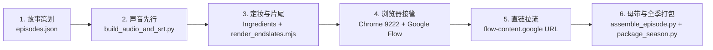

# google-flow-story-video

面向 AI 编程与创作代理（Antigravity、Claude Code、Gemini CLI、Codex 等）的 **Google Flow 连续故事宣传片全流程制作 Skill**。覆盖从分集叙事策划、神经语音与多语外置字幕生成、Chrome 远程接管 [Google Flow](https://flow.google.com/) 保持角色一致性出片、签名 CDN 视频直链提取下载，到 `ffmpeg` 无痕母带压制与全季无损合集打包的完整工程闭环。

适合需要批量制作产品世界观短剧、游戏剧情宣传片、TikTok / YouTube Shorts 竖屏连续剧及 YouTube 全季合集长片的开发者与创作者。Agent 执行细则见 [SKILL.md](./SKILL.md)，JSON 结构与提示词公式见 [references/manifest-schema-and-prompts.md](./references/manifest-schema-and-prompts.md)。



---

## 核心能力

1. **连续剧 × 单元爽片双层叙事法**
   - 单主角全季成长主线串联 + 单集独立冲突，兼顾路人单集完播率与全季追更粘性；
   - 适配 Google Flow 8 秒单镜上限的「`0–6s` 开屏钩子 → 危机具象化 → 高潮兑现 → 切黑悬念 + 矢量落版」黄金四段式；
   - 干净无字母带搭配外置多语 `.srt`（内置英 / 日 / 简中 / 繁中 / 韩语轨道支持）与单行字数预算规范。
2. **Audio-First 声音先行时间轴**
   - 先调用 `edge-tts` 生成英文旁白并用 `ffprobe` 实测毫秒级时长，自动反推每个视频镜头所需秒数并导出 `timeline.json`；
   - 内置 8 种调性的 48kHz 立体声氛围音床合成器（含空灵钟琴节点与超低频悬念震动），同时支持 `--bgm` 传入外部配乐。
3. **Google Flow 角色锁脸与浏览器自动化**
   - 全季共享 6–8 张 `9:16` Ingredients 定妆参考图，内置非人形世界观防漂移质检清单；
   - 提供英 / 中 / 日三语 Google Flow 工作台参数对照表（关闭可见水印与对话 Agent 模式，锁定 `Omni 1.2 Flash` 高性价比配置）；
   - 记录 macOS `DevToolsActivePort` 权限授权方案与 `upload_file` 工作区临时目录中转规范。
4. **免弹窗签名 CDN 直链下载**
   - 直接读取 `<video>.currentSrc` 或网络日志中的 `https://flow-content.google/video/...` 免 Cookie 签名直链并通过 `curl` 拉取，避开 Chrome 远程下载生成 `.com.google.Chrome.*` 隐藏临时文件及串镜错位问题。
5. **FFmpeg 无痕合成与全季无损合集**
   - 用 `geq` 幂函数透明底部渐变层替代 `drawbox` 半透明黑条，消除水平分割硬边；
   - 超 8 秒台词自动计算 `setpts` 平滑慢放对齐时长，同步输出干净母带、内封 `mov_text` 多语软字幕审片版及关键帧质检截图；
   - 收官阶段使用 `ffmpeg -f concat -c copy` 零重编码秒拼全季大电影，自动累加偏移合并全季 `.srt` 并生成 YouTube Chapters 章节时间轴。

---

## 安装

### 方式一：使用 Skills CLI 一键安装（推荐）

```bash
npx skills add baryon/google-flow-story-video -g -y
```

### 方式二：Git 克隆安装

```bash
git clone git@github.com:baryon/google-flow-story-video.git ~/.agents/skills/google-flow-story-video

# 按需软链至 Claude Code / Gemini CLI 技能目录
mkdir -p ~/.claude/skills ~/.gemini/config/skills
ln -sfn ../../.agents/skills/google-flow-story-video ~/.claude/skills/google-flow-story-video
ln -sfn ../../../.agents/skills/google-flow-story-video ~/.gemini/config/skills/google-flow-story-video
```

---

## 环境依赖

| 依赖项 | 用途 | macOS 安装示例 |
|---|---|---|
| `Python >= 3.10` | 运行配音、单集合成与全季打包脚本 | 系统自带或 `brew install python` |
| `Node.js >= 18` | 运行零依赖矢量片尾渲染脚本 | `brew install node` |
| `ffmpeg` / `ffprobe` | 音频滤波混音、透明渐变叠加、视频封装与质检抽帧 | `brew install ffmpeg` |
| `edge-tts` 或 `uv` | 生成神经英语旁白（脚本优先查找 `edge-tts`，未安装时自动回退至 `uvx`） | `pipx install edge-tts` 或 `brew install uv` |
| `Google Chrome` | 远程接管 Google Flow 及无头渲染 `1080×1920` 品牌矢量落版 | 已登录 Google 账号的本机 Chrome |

---

## 快速开始

### 1. 在 AI Agent 中直接调用

在已安装本 Skill 的 Agent 会话中：

1. 打开本机 Chrome 访问 `chrome://inspect/#remote-debugging`，勾选开启远程调试（确认显示 `Server running at: 127.0.0.1:9222`）。
2. 发送指令示例：
   > 使用 `google-flow-story-video` 技能，基于项目世界观策划一季 10 集的竖屏宣传片（片尾域名 `example.com`），先给我看分集大纲和第 1 集三语分镜脚本，确认后再用 Google Flow 生成并打包。

### 2. 命令行独立运行验证（基于 `examples/`）

无需启动浏览器，即可先在本地验证音频时间轴、多语字幕与品牌矢量片尾生成：

```bash
SKILL_DIR="$HOME/.agents/skills/google-flow-story-video"

# 1) 生成英文旁白、毫秒级 timeline.json、英/日/中 .srt 与立体声混音母带
python3 "$SKILL_DIR/scripts/build_audio_and_srt.py" \
  --manifest "$SKILL_DIR/examples/episodes.sample.json" \
  --out-dir /tmp/demo-build/audio

# 2) 用本机无头 Chrome 将官方矢量 SVG 渲染为 1080x1920 片尾 PNG
node "$SKILL_DIR/scripts/render_endslates.mjs" \
  --logo "$SKILL_DIR/examples/sample-logo.svg" \
  --series "THE BOOK OF LIFE" \
  --volume "VOLUME I" \
  --domain "example.com" \
  --count 1 \
  --out-dir /tmp/demo-build/endslates
```

拿到 Google Flow 各镜签名直链并写入 `mapping.json`（格式见 [examples/mapping.sample.json](./examples/mapping.sample.json)）后，合成单集并打包全季：

```bash
# 3) 自动拉取 Flow 直链、叠加无痕字幕底渐变、合成单集双版本母带并抽帧质检
python3 "$SKILL_DIR/scripts/assemble_episode.py" \
  --timeline /tmp/demo-build/audio/ep01/timeline.json \
  --audio /tmp/demo-build/audio/ep01/ep01-audio-master.wav \
  --endslate /tmp/demo-build/endslates/ep01-endslate.png \
  --mapping ./mapping.json \
  --srt-dir /tmp/demo-build/audio/ep01 \
  --out-dir /tmp/demo-build/masters/ep01

# 4) 全季收官：输出分集上传包 + 零重编码无损全季合集 + YouTube 章节时间戳
python3 "$SKILL_DIR/scripts/package_season.py" \
  --manifest "$SKILL_DIR/examples/episodes.sample.json" \
  --masters-dir /tmp/demo-build/masters \
  --audio-dir /tmp/demo-build/audio \
  --series-slug demo-series-s1 \
  --site-url https://example.com \
  --out-dir /tmp/demo-build/dist
```

---

## 目录结构

```text
google-flow-story-video/
├── SKILL.md                                  # 核心工作流规范（故事、视频、浏览器操控、直链下载、打包）
├── README.md                                 # 仓库说明与快速上手指南
├── LICENSE                                   # MIT 开源协议
├── references/
│   └── manifest-schema-and-prompts.md        # episodes.json / mapping.json 规范、8 种音床预设与提示词公式
├── scripts/
│   ├── build_audio_and_srt.py                # 配音测时、多语 .srt 生成与氛围音轨混音
│   ├── render_endslates.mjs                  # 无头 Chrome 渲染官方矢量品牌落版（零 npm 依赖）
│   ├── assemble_episode.py                   # CDN 直链拉流、无痕底部渐变、时长对齐与双母带压制
│   └── package_season.py                     # 分集整理、无损全季合集拼接与 YouTube Chapters 生成
└── examples/
    ├── episodes.sample.json                  # 最小可运行分集清单示例
    ├── mapping.sample.json                   # Google Flow 签名直链映射表模板
    └── sample-logo.svg                       # 示例矢量品牌标志
```

### 最终交付包产物结构（`package_season.py` 输出）

```text
<out-dir>/
├── README.txt                                # YouTube Chapters 时间戳 + 多语分集标题清单
├── episodes/
│   └── ep01/
│       ├── <series>-ep01-clean.mp4           # 干净无字母带（TikTok / Shorts / YouTube 发布用）
│       ├── <series>-ep01-multilang.mp4       # 内封多语软字幕审片版（QuickTime / VLC 可切换字幕）
│       ├── <series>-ep01.en.srt              # 外挂英文字幕
│       ├── <series>-ep01.ja.srt              # 外挂日文字幕
│       └── <series>-ep01.zh-Hans.srt         # 外挂简体中文字幕
└── full-movie/
    ├── <series>-full-clean.mp4               # 零重编码无损全季合集长片
    ├── <series>-full-multilang.mp4           # 内封全季多语软字幕合集版
    ├── <series>-full.en.srt                  # 自动顺延时间轴的全季英文字幕
    ├── <series>-full.ja.srt                  # 自动顺延时间轴的全季日文字幕
    └── <series>-full.zh-Hans.srt             # 自动顺延时间轴的全季简体中文字幕
```

---

## 常见问题排障

### 1. 连接 Chrome 时报 `EPERM: operation not permitted, open '.../DevToolsActivePort'`
macOS 隐私沙盒默认阻止未授权进程读取 `~/Library/Application Support/Google/Chrome/DevToolsActivePort`。打开「**系统设置 → 隐私与安全性 → 完全磁盘访问权限**」，勾选当前运行的 Agent CLI 可执行文件（如 `~/.local/bin/agy`）与终端应用（如 `Terminal.app`、`iTerm.app`、`Herdr.app`），重连即可。

### 2. 上传 Ingredients 参考图时报 `Access denied`
`chrome_devtools` 的 `upload_file` 工具仅允许读取当前工作区根目录内的路径。先将质检通过的参考图复制到 `<workspace>/.tmp-flow-ingredients/` 完成一次性上传，确认上传成功后立即删除 `.tmp-flow-ingredients/`。

### 3. Google Flow 底部看不到模型（`Omni 1.2 Flash`）和比例选择栏
新建项目后默认开启了输入框内的 **`Flow Agent` / `Flow 智能体` / `Flow エージェント`** 对话开关。先关闭该开关，底部即会展开完整的 `Video`、`Ingredients`、`Omni 1.2 Flash`、`9:16`、`x1` 参数栏。

### 4. `assemble_episode.py` 拉取 `flow-content.google` 链接返回 HTTP 403
签名 CDN 直链有效期约为 6 小时。重新打开对应的 Google Flow 项目页读取最新 `video.currentSrc` 更新 `mapping.json` 即可直接拉流，无需重新消耗积分生成视频。

---

## License

[MIT](./LICENSE)
