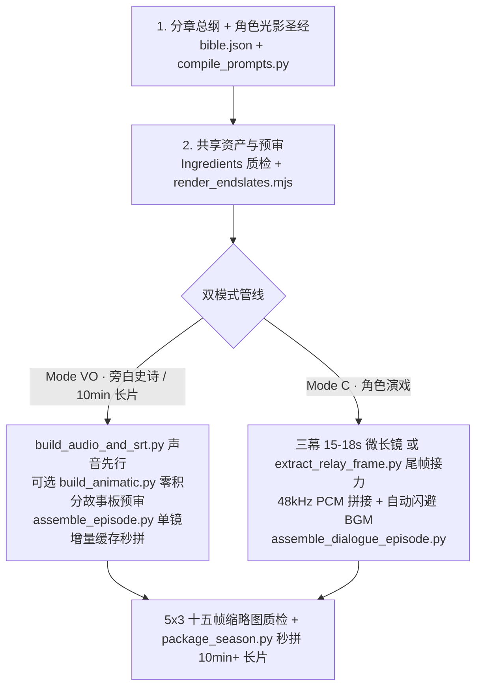

# google-flow-story-video

面向 AI 编程与创作代理（Antigravity、Claude Code、Gemini CLI、Codex 等）的 **Google Flow 连续故事短剧与 10 分钟级长片全流程制作 Skill**。内置**旁白史诗模式（Mode VO）**与**角色开口演戏模式（Mode C）**双管线，覆盖「角色与光影圣经」自动拼词、零积分有声故事板预审、Chrome 接管 [Google Flow](https://flow.google.com/) 生成、真视频尾帧接力、免弹窗签名 CDN 直链拉取，以及单镜增量热替换合成与全季无损合集打包。

Agent 执行细则见 [SKILL.md](./SKILL.md)，JSON 清单与提示词公式见 [references/manifest-schema-and-prompts.md](./references/manifest-schema-and-prompts.md)。



---

## 核心能力

1. **双模式制片 + 10 分钟级模块化拆章**
   - **Mode VO（旁白史诗 / 10 分钟长片）**：将 10 分钟长片拆为 8–10 个独立 60s 章节，`edge-tts` 声音先行测准毫秒级时间轴；支持在投入视频积分前通过 `build_animatic.py` 一键合成**零积分有声动态故事板（Animatic）**前置审片；
   - **Mode C（角色直接开口演戏）**：采用「三幕 × 15–18s 微长镜（SceneBuilder 单次续写）」黄金时序；遇到需要 24–32s 连续同场戏或局部重抽后半拍时，使用 `extract_relay_frame.py` **真视频尾帧接力法**重置第 1 代满血画质。
2. **结构化「角色与光影圣经（`bible.json`）」自动编译校验**
   - `compile_prompts.py` 将全局画风、光影色温及每个角色的固定外观词（`visual_tag`）与声线词（`voice_tag`）程序化注入每条提示词，跑完 80 个镜头零漂移；
   - 开拍前自动静态拦截「单镜超过 2 张参考图（防串色）」「单拍台词超过 12 词（防 8s 切词）」及自动补齐 `full-bleed 9:16 edge-to-edge, NO black bars` 防黑边后缀。
3. **广播级混音与单镜级秒级热替换缓存**
   - 统一采用 **48kHz 立体声 PCM 解码拼接**（杜绝多段 AAC `-c copy` 尾段丢声），内置 8 种调性氛围合成器 + `sidechaincompress` 对白自动闪避 + `silencedetect` 零死寂校验 + 音画同步 `< 0.35s` 硬断言；
   - 内置 URL 指纹追踪（`raw/<id>.url`）与 SHA-256 分镜签名缓存（`*.sig`）：哪一镜抽崩了只需重跑那 8 秒并替换 URL，重跑脚本将 **0 毫秒跳过其余所有未改镜头**，数秒内热更新整条成片。
4. **免弹窗签名 CDN 直链下载与 15 帧矩阵质检**
   - 直接提取 `flow-content.google` 签名视频直链并用 `curl` 高速拉取，彻底避开 Chrome 下载隐藏临时文件（`.com.google.Chrome.*`）与串镜问题；
   - 每集自动输出 `qa-contact-5x3.png`（全片 15 帧 `5×3` 缩略图矩阵），收官阶段 `ffmpeg -f concat -c copy` 零重编码秒拼全季/10 分钟长片并生成 YouTube Chapters。

---

## 安装

### 方式一：使用 Skills CLI 一键安装（推荐）

```bash
npx skills add baryon/google-flow-story-video -g -y
```

### 方式二：Git 克隆安装

```bash
git clone git@github.com:baryon/google-flow-story-video.git ~/.agents/skills/google-flow-story-video

# 按需软链至 Claude Code / Gemini CLI 技能目录
mkdir -p ~/.claude/skills ~/.gemini/config/skills
ln -sfn ../../.agents/skills/google-flow-story-video ~/.claude/skills/google-flow-story-video
ln -sfn ../../../.agents/skills/google-flow-story-video ~/.gemini/config/skills/google-flow-story-video
```

---

## 环境依赖

| 依赖项 | 用途 | macOS 安装示例 |
|---|---|---|
| `Python >= 3.10` | 运行圣经编译、配音、故事板、单集合成与全季打包脚本 | 系统自带或 `brew install python` |
| `Node.js >= 18` | 运行零依赖矢量片尾渲染脚本 | `brew install node` |
| `ffmpeg` / `ffprobe` | PCM 拼接、侧链自动闪避、尾帧提取、透明渐变与 15 帧抽检 | `brew install ffmpeg` |
| `edge-tts` 或 `uv` | Mode VO 生成神经旁白（优先查找 `edge-tts`，自动回退 `uvx`） | `pipx install edge-tts` 或 `brew install uv` |
| `Google Chrome` | 远程接管 Google Flow 及无头渲染 `1080×1920` 品牌矢量落版 | 已登录 Google 账号的本机 Chrome |

---

## 快速开始

### 1. 在 AI Agent 中直接调用

打开本机 Chrome 访问 `chrome://inspect/#remote-debugging` 勾选开启远程调试（`127.0.0.1:9222`），然后发送指令：

- **10 分钟长片 / 旁白连载（Mode VO）**：
  > 使用 `google-flow-story-video` 策划一部 10 分钟（拆 8 章）的世界观宣传长片，先建立 `bible.json` 和分章脚本，生成零积分有声故事板给我审节奏，通过后再进 Google Flow 出片合成。
- **角色开口演戏短剧（Mode C）**：
  > 使用 `google-flow-story-video` 的 Mode C 模式制作连载动画短剧，先锁整季总纲、`bible.json` 角色音色与第 1 集三幕剧本。

### 2. 命令行工具链速览

```bash
SKILL_DIR="$HOME/.agents/skills/google-flow-story-video"

# 1) 基于角色与光影圣经自动注入提示词并校验 <=2 张参考图 / <=12 词限制
python3 "$SKILL_DIR/scripts/compile_prompts.py" \
  --bible "$SKILL_DIR/examples/bible.sample.json" \
  --manifest "$SKILL_DIR/examples/episodes.sample.json" \
  --out /tmp/demo-build/episodes.compiled.json \
  --sheet-out /tmp/demo-build/flow-shotlist.md

# 2) 渲染 1080x1920 官方矢量片尾落版
node "$SKILL_DIR/scripts/render_endslates.mjs" \
  --logo "$SKILL_DIR/examples/sample-logo.svg" \
  --series "THE BOOK OF LIFE" --volume "VOLUME I" --domain "example.com" \
  --count 1 --out-dir /tmp/demo-build/endslates

# 3) [Mode VO] 生成配音与字幕 -> 先出零积分有声故事板预审 -> Flow 出片后增量热替换合成
python3 "$SKILL_DIR/scripts/build_audio_and_srt.py" \
  --manifest /tmp/demo-build/episodes.compiled.json --out-dir /tmp/demo-build/audio

python3 "$SKILL_DIR/scripts/build_animatic.py" \
  --timeline /tmp/demo-build/audio/ep01/timeline.json \
  --audio /tmp/demo-build/audio/ep01/ep01-audio-master.wav \
  --endslate /tmp/demo-build/endslates/ep01-endslate.png \
  --srt-dir /tmp/demo-build/audio/ep01 \
  --out /tmp/demo-build/animatics/ep01-animatic.mp4

python3 "$SKILL_DIR/scripts/assemble_episode.py" \
  --timeline /tmp/demo-build/audio/ep01/timeline.json \
  --audio /tmp/demo-build/audio/ep01/ep01-audio-master.wav \
  --endslate /tmp/demo-build/endslates/ep01-endslate.png \
  --mapping ./mapping.json --srt-dir /tmp/demo-build/audio/ep01 \
  --out-dir /tmp/demo-build/masters/ep01

# 4) [Mode C] 提取清晰尾帧做 24s+ 尾帧接力（按需） & 三幕原生对白合成
python3 "$SKILL_DIR/scripts/extract_relay_frame.py" \
  --src ./act1-part1.mp4 --out ./.tmp-flow-ingredients/relay-act1.png

python3 "$SKILL_DIR/scripts/assemble_dialogue_episode.py" \
  --episode ./dialogue-episode.json \
  --endslate /tmp/demo-build/endslates/ep01-endslate.png \
  --out-dir /tmp/demo-build/masters/ep01

# 5) 零重编码秒拼全季 / 10 分钟完整长片 + YouTube Chapters
python3 "$SKILL_DIR/scripts/package_season.py" \
  --manifest /tmp/demo-build/episodes.compiled.json \
  --masters-dir /tmp/demo-build/masters --audio-dir /tmp/demo-build/audio \
  --series-slug demo-series-s1 --site-url https://example.com \
  --out-dir /tmp/demo-build/dist
```

---

## 目录结构

```text
google-flow-story-video/
├── SKILL.md                                  # 核心工作流规范（双模式、10min 拆章、尾帧接力、防坑铁律）
├── README.md                                 # 仓库说明与工具链速查
├── LICENSE                                   # MIT 开源协议
├── references/
│   └── manifest-schema-and-prompts.md        # bible.json / Mode VO / Mode C 规范与提示词公式
├── scripts/
│   ├── compile_prompts.py                    # [通用] 角色与光影圣经自动拼词及 <=2 图 / <=12 词前置校验
│   ├── extract_relay_frame.py                # [通用] 提取视频最清晰尾帧用于 Frames 首帧接力（突破 15s）
│   ├── render_endslates.mjs                  # [通用] 无头 Chrome 渲染官方矢量品牌落版（零 npm 依赖）
│   ├── build_audio_and_srt.py                # [Mode VO] 配音测时、多语 .srt 生成与氛围音轨混音
│   ├── build_animatic.py                     # [Mode VO] 跑 Flow 前生成零积分有声动态故事板（Animatic）
│   ├── assemble_episode.py                   # [Mode VO] 直链拉流、增量缓存秒级热替换与 5x3 缩略图质检
│   ├── assemble_dialogue_episode.py          # [Mode C] 三幕 PCM 拼接、自动闪避 BGM、增量缓存与零死寂校验
│   └── package_season.py                     # [通用] 分集整理、无损全季/10min 长片拼接与 YouTube Chapters
└── examples/
    ├── bible.sample.json                     # 角色外观、声线与全局光影圣经示例
    ├── episodes.sample.json                  # Mode VO 分集清单示例
    ├── dialogue-episode.sample.json          # Mode C 三幕角色演戏清单示例
    ├── mapping.sample.json                   # Google Flow 签名直链映射表模板
    └── sample-logo.svg                       # 示例矢量品牌标志
```

---

## 常见问题排障

- **连接 Chrome 报 `EPERM: operation not permitted, open '.../DevToolsActivePort'`**：在 macOS「系统设置 → 隐私与安全性 → 完全磁盘访问权限」勾选当前 Agent CLI（如 `~/.local/bin/agy`）与宿主终端 App。
- **上传参考图报 `Access denied`**：先将参考图或接力尾帧复制到 `<workspace>/.tmp-flow-ingredients/` 上传，完成后立即删除该临时目录。
- **底部看不到 `Omni 1.2 Flash` 参数栏**：关闭输入框内的 `Flow Agent` / `Flow 智能体` / `Flow エージェント` 开关即可展开。
- **拉取 `flow-content.google` 返回 HTTP 403**：签名直链约 6 小时过期，回 Flow 项目页刷新读取最新 `video.currentSrc` 即可（未换镜的已缓存片段不会重复重编）。

---

## License

[MIT](./LICENSE)
