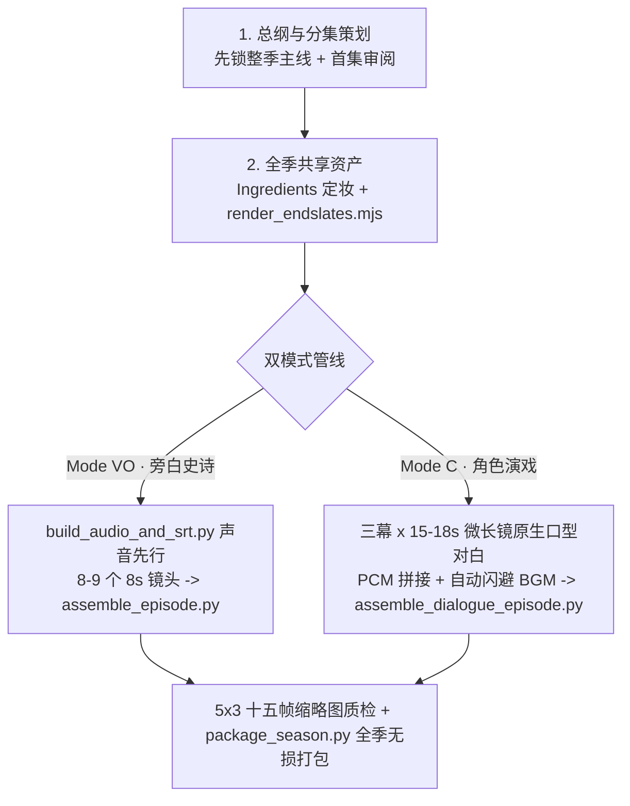

# google-flow-story-video

面向 AI 编程与创作代理（Antigravity、Claude Code、Gemini CLI、Codex 等）的 **Google Flow 连续故事视频全流程制作 Skill**。内置两套经过多季实拍验证的制片工艺——**旁白史诗宣传片模式（Mode VO）**与**角色开口演戏动画剧模式（Mode C）**，打通分集叙事策划、定妆锁脸、Chrome 远程接管 [Google Flow](https://flow.google.com/) 生成、免弹窗签名 CDN 直链拉取，以及 `ffmpeg` 无痕母带压制与全季无损合集打包的完整闭环。

适合制作产品/游戏世界观宣传片、皮克斯/吉卜力式连载动画短剧、TikTok / YouTube Shorts 竖屏连续剧及 YouTube 全季合集长片。Agent 执行规范见 [SKILL.md](./SKILL.md)，JSON 清单与提示词公式见 [references/manifest-schema-and-prompts.md](./references/manifest-schema-and-prompts.md)。



---

## 核心能力

1. **双模式制片架构（旁白史诗 vs 角色直接演戏）**
   - **Mode VO（声音先行）**：`edge-tts` 先生成英文神经旁白并实测毫秒级时长，反推 8–9 个独立 8 秒镜头的精确秒数（单集 `60–75s`），适合宏大设定与预告片；
   - **Mode C（三幕 × 15–18s 微长镜）**：每幕在 SceneBuilder 最多续写 1 次（`8s + 7~8s`，尾钩可 `+10s`，单集 `48–55s`），兼顾同场零跳切与高画质锐度，完整保留角色原生口型、笑声与情绪对白。
2. **实战级防翻车护栏（防黑边 · 防串色 · 防风控）**
   - 统一强制 `full-bleed 9:16 edge-to-edge, NO black bars, NO letterbox` 后缀（替代易诱发硬黑边的 `dark lower third`），底部字幕暗化全部交由本地 `ffmpeg geq` 幂函数透明渐变无痕叠加；
   - `Omni 1.2 Flash` 单镜严格限制 **≤ 2 张 Ingredients 参考图**杜绝角色串色，浏览器每次提交保持 **8–12 秒**自然间隔规避异常活动风控。
3. **广播级音频工程（48kHz PCM 拼接 + 自动闪避 BGM + 零死寂校验）**
   - 摒弃易导致尾段丢声的多段 AAC `-c copy` 硬拼，统一解码为 **48kHz 立体声 PCM** 后拼接；
   - 内置 8 种调性的立体声氛围合成器（亦支持 `--bgm` 外部配乐），通过 `sidechaincompress` 在角色开口时自动压低配乐、反应拍柔和托起，并自动执行 `silencedetect` 零死寂检测与音画时长差 `< 0.35s` 硬断言。
4. **免弹窗签名 CDN 直链下载与 15 帧可视化质检**
   - 直接读取 `flow-content.google` 签名视频直链并用 `curl` 高速拉取，彻底绕开 Chrome 远程下载产生 `.com.google.Chrome.*` 隐藏临时文件及串镜错位问题；
   - 每集自动生成 `qa-contact-5x3.png`（全片 15 帧 `5×3` 缩略图矩阵）供视觉质检，收官阶段 `ffmpeg -f concat -c copy` 零重编码秒拼全季大电影并生成 YouTube Chapters。

---

## 安装

### 方式一：使用 Skills CLI 一键安装（推荐）

```bash
npx skills add baryon/google-flow-story-video -g -y
```

### 方式二：Git 克隆安装

```bash
git clone git@github.com:baryon/google-flow-story-video.git ~/.agents/skills/google-flow-story-video

# 按需软链至 Claude Code / Gemini CLI 技能目录
mkdir -p ~/.claude/skills ~/.gemini/config/skills
ln -sfn ../../.agents/skills/google-flow-story-video ~/.claude/skills/google-flow-story-video
ln -sfn ../../../.agents/skills/google-flow-story-video ~/.gemini/config/skills/google-flow-story-video
```

---

## 环境依赖

| 依赖项 | 用途 | macOS 安装示例 |
|---|---|---|
| `Python >= 3.10` | 运行配音、单集合成（Mode VO / Mode C）与全季打包脚本 | 系统自带或 `brew install python` |
| `Node.js >= 18` | 运行零依赖矢量片尾渲染脚本 | `brew install node` |
| `ffmpeg` / `ffprobe` | PCM 拼接、侧链自动闪避、透明渐变叠加、封装与 15 帧抽检 | `brew install ffmpeg` |
| `edge-tts` 或 `uv` | Mode VO 生成神经旁白（优先查找 `edge-tts`，自动回退 `uvx`） | `pipx install edge-tts` 或 `brew install uv` |
| `Google Chrome` | 远程接管 Google Flow 及无头渲染 `1080×1920` 品牌矢量落版 | 已登录 Google 账号的本机 Chrome |

---

## 快速开始

### 1. 在 AI Agent 中直接调用

1. 打开本机 Chrome 访问 `chrome://inspect/#remote-debugging`，勾选开启远程调试（确认显示 `Server running at: 127.0.0.1:9222`）。
2. 发送指令示例：
   - **旁白史诗模式（Mode VO）**：
     > 使用 `google-flow-story-video` 的旁白模式，基于项目世界观策划一季 10 集竖屏宣传片（片尾域名 `example.com`），先给我审阅总纲和第 1 集三语脚本。
   - **角色演戏模式（Mode C）**：
     > 使用 `google-flow-story-video` 的 Mode C 角色对话动画模式，策划一季连载动画短剧（三幕 15 秒微长镜，角色直接开口对白），先输出整季总故事大纲与第 1 集三幕剧本。

### 2. 命令行独立运行验证

```bash
SKILL_DIR="$HOME/.agents/skills/google-flow-story-video"

# 渲染 1080x1920 官方矢量片尾落版（两种模式通用）
node "$SKILL_DIR/scripts/render_endslates.mjs" \
  --logo "$SKILL_DIR/examples/sample-logo.svg" \
  --series "THE BOOK OF LIFE" \
  --volume "VOLUME I" \
  --domain "example.com" \
  --count 1 \
  --out-dir /tmp/demo-build/endslates

# [Mode VO] 生成配音、毫秒级 timeline.json、多语 .srt 与氛围母带，再合成单集
python3 "$SKILL_DIR/scripts/build_audio_and_srt.py" \
  --manifest "$SKILL_DIR/examples/episodes.sample.json" \
  --out-dir /tmp/demo-build/audio

python3 "$SKILL_DIR/scripts/assemble_episode.py" \
  --timeline /tmp/demo-build/audio/ep01/timeline.json \
  --audio /tmp/demo-build/audio/ep01/ep01-audio-master.wav \
  --endslate /tmp/demo-build/endslates/ep01-endslate.png \
  --mapping ./mapping.json \
  --srt-dir /tmp/demo-build/audio/ep01 \
  --out-dir /tmp/demo-build/masters/ep01

# [Mode C] 三幕原生对白 PCM 拼接 + 全程自动闪避 BGM + 零死寂校验 + 5x3 缩略图抽检
python3 "$SKILL_DIR/scripts/assemble_dialogue_episode.py" \
  --episode ./dialogue-episode.json \
  --endslate /tmp/demo-build/endslates/ep01-endslate.png \
  --srt-dir /tmp/demo-build/subs/ep01 \
  --out-dir /tmp/demo-build/masters/ep01

# 全季无损合集打包（Mode VO 与 Mode C 通用）
python3 "$SKILL_DIR/scripts/package_season.py" \
  --manifest "$SKILL_DIR/examples/episodes.sample.json" \
  --masters-dir /tmp/demo-build/masters \
  --audio-dir /tmp/demo-build/audio \
  --series-slug demo-series-s1 \
  --site-url https://example.com \
  --out-dir /tmp/demo-build/dist
```

---

## 目录结构

```text
google-flow-story-video/
├── SKILL.md                                  # 核心工作流规范（双模式选型、叙事、防坑铁律、浏览器与下载）
├── README.md                                 # 仓库说明与快速上手指南
├── LICENSE                                   # MIT 开源协议
├── references/
│   └── manifest-schema-and-prompts.md        # Mode VO / Mode C JSON 规范、音床预设与提示词公式
├── scripts/
│   ├── build_audio_and_srt.py                # [Mode VO] 配音测时、多语 .srt 生成与氛围音轨混音
│   ├── assemble_episode.py                   # [Mode VO] 直链拉流、无痕渐变、弹性对齐与 5x3 抽帧质检
│   ├── assemble_dialogue_episode.py          # [Mode C] 三幕 PCM 拼接、侧链自动闪避 BGM 与零死寂校验
│   ├── render_endslates.mjs                  # [通用] 无头 Chrome 渲染官方矢量品牌落版（零 npm 依赖）
│   └── package_season.py                     # [通用] 分集整理、无损全季合集拼接与 YouTube Chapters 生成
└── examples/
    ├── episodes.sample.json                  # Mode VO 分集清单示例
    ├── dialogue-episode.sample.json          # Mode C 三幕角色演戏清单示例
    ├── mapping.sample.json                   # Google Flow 签名直链映射表模板
    └── sample-logo.svg                       # 示例矢量品牌标志
```

---

## 常见问题排障

### 1. 连接 Chrome 时报 `EPERM: operation not permitted, open '.../DevToolsActivePort'`
macOS 隐私沙盒默认阻止未授权进程读取 `~/Library/Application Support/Google/Chrome/DevToolsActivePort`。打开「**系统设置 → 隐私与安全性 → 完全磁盘访问权限**」，勾选当前 Agent CLI 可执行文件（如 `~/.local/bin/agy`）与终端应用（如 `Terminal.app`、`iTerm.app`、`Herdr.app`），重连即可。

### 2. 上传 Ingredients 参考图时报 `Access denied`
`chrome_devtools` 的 `upload_file` 仅允许读取当前工作区根目录内的路径。先将质检通过的参考图复制到 `<workspace>/.tmp-flow-ingredients/` 完成一次性上传，确认上传成功后立即删除 `.tmp-flow-ingredients/`。

### 3. Google Flow 底部看不到模型（`Omni 1.2 Flash`）和比例选择栏
新建项目后默认开启了输入框内的 **`Flow Agent` / `Flow 智能体` / `Flow エージェント`** 对话开关。先关闭该开关，底部即会展开完整的 `Video`、`Ingredients`、`Omni 1.2 Flash`、`9:16`、`x1` 参数栏。

### 4. 拉取 `flow-content.google` 链接返回 HTTP 403
签名 CDN 直链有效期约为 6 小时。重新打开对应的 Google Flow 项目页读取最新 `video.currentSrc` 更新 JSON 即可直接拉流，无需重新消耗积分生成视频。

---

## License

[MIT](./LICENSE)
