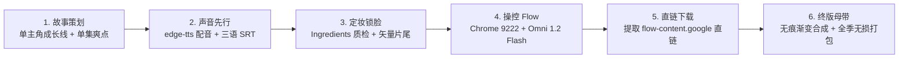

# Google Flow 连续故事宣传片全流程制作指南

本技能提供一套经过全季 10 集（89 个实拍镜头）验证的端到端视频生产流水线，覆盖**连续故事策划**、**配音与多语外置字幕先行**、**浏览器接管 Google Flow 锁定角色一致性生成**、**签名 CDN 视频直链提取下载**，以及 **`ffmpeg` 无痕合成单集与全季合集长片**。

- 配套自动化脚本：`./scripts/`（以本 `SKILL.md` 所在目录为基准，全局安装时默认位于 `~/.agents/skills/google-flow-story-video/scripts/`）
- 数据结构与提示词模板：[manifest-schema-and-prompts.md](./references/manifest-schema-and-prompts.md)
- 最小可运行示例：[episodes.sample.json](./examples/episodes.sample.json)、[mapping.sample.json](./examples/mapping.sample.json)、[sample-logo.svg](./examples/sample-logo.svg)

---

## 0. 整体流水线总览



执行顺序不可颠倒：**先审策划 → 再做音频定精确秒数 → 质检定妆参考图 → 进 Google Flow 跑画面 → 直链拉流合成质检**。

---

## 1. 故事怎么讲（连续剧 × 单元爽片叙事法）

直接朗读世界观设定集会导致观众在前 2 秒划走；做成嘈杂买量广告则会破坏作品气质。推荐采用**「电影旁白的克制声线 + 短剧的高密度剪辑 + 单主角连续成长线」**。

### 1.1 双层连续结构（兼顾单集完播与全季追更）

- **一根主线串全季**：不要写成空泛的世界观百科。全季（建议 8–12 集）始终锁定**同一位主角**从微弱起点一路蜕变、破局、登顶的成长弧线；收官集首尾呼应第 1 集意象，留白引出下一季。
- **一集只讲透一件事**：路人刷到中间任意一集也必须**零前置门槛看懂**。每集只聚焦一个核心冲突或奇观（如：死而复生、首次融合、择道立誓、越级反杀、限时追猎夺回、终局镜像战）。
- **首尾咬合追更链**：上一集最后 4 秒的危机或悬念（Cliffhanger），直接作为下一集前 3 秒的开屏爆发点。
- **第二人称 `"You"` 视角绑定**：旁白直接对屏幕前的 `"You"`（你）说话（例如 *"Until you looked at her."* / *"You chose her path."*），让观众与主角形成命运绑定。

### 1.2 单集黄金四段式（60–75 秒 / 8–9 个镜头）

Google Flow 单镜上限为 **8 秒**，竖屏短视频最佳视觉切换频率也是 **5–8 秒一镜**，按以下四段排布分镜：

| 段落 | 时间区间 | 对应镜号 | 叙事任务与写法 |
|---|---|---|---|
| **① 开屏即爽 Hook** | `0–6s` | `s01` | **第一句台词 + 第一帧画面直接给出反常识冲突或奇观结果**（例：*"She shattered into dust seven times—but refused to stay dead."*）。不做慢热背景铺垫。 |
| **② 规则具象化 & 危机** | `6–28s` | `s02`–`s04` | 用具象动作与短句交代本集核心规则与压迫感，**禁止说明书式机制科普**。 |
| **③ 高潮兑现** | `28–55s` | `s05`–`s07` | 蜕变爆发、看穿杀招反制、绝地夺回或加冕时刻，画面动态与听觉情绪推至顶点。 |
| **④ 余韵 + 下集钩子** | `55–68s` | `s08`–`s09` | 局势骤变或更大阴影浮现，末句点出 `Next: ...` 悬念；最后一镜干脆切黑，接 `3.8–4.0s` 官方品牌片尾落版。 |

### 1.3 文案、配音与多语外置字幕规范

1. **严守世界观边界**：正片配音与字幕中**不出现**「下载、充值、福利、代码、AI、区块链」等出戏词汇；品牌 Logo 与官网域名（**开拍前必须向用户核准精确域名**）只出现在片尾落版。
2. **语速与呼吸留白**：英文旁白控制在 **125–135 词/分钟**（单集 85–105 词）。每镜配音前预留 `0.30–0.45s` 画面呼吸，配音后预留 `0.60–0.85s` 尾音留白。
3. **干净母带 + 外置多语 `.srt`**：
   - 视频母带画面内**不烧录硬字幕、不贴 UI 框**，画面底部 25% 保持深色平静暗部；
   - 同步产出毫秒级对轴的 `.en.srt`、`.ja.srt`、`.zh-Hans.srt`（还可扩展 `.zh-Hant.srt`、`.ko.srt`）；
   - **单屏字数上限**：英文单行 ≤ 32 字符、日文单行 ≤ 16 全角字符、中文单行 ≤ 14 字，每次最多 2 行；全季动工前先锁定《多语专有名词对照表》，保证各集译名一致。
4. **审阅前置**：先输出整季分集大纲 + 第 1 集完整多语台词与分镜表供用户确认，获批后再进入批量生成。

---

## 2. 视频怎么做（声音先行 + 定妆锁脸 + FFmpeg 母带工程）

### 2.1 第一步：声音先行，自动测定时间轴与多语 `.srt`

每句英文台词的实际朗读时长决定了对应镜头需要多长（`5.2s` 还是 `8.4s`）。先生成配音与混音母带，即可自动算出精确到毫秒的 `timeline.json`。

按 [manifest-schema-and-prompts.md](./references/manifest-schema-and-prompts.md) 编写 `episodes.json` 后运行：

```bash
SKILL_DIR="${SKILL_DIR:-$HOME/.agents/skills/google-flow-story-video}"

python3 "$SKILL_DIR/scripts/build_audio_and_srt.py" \
  --manifest episodes.json \
  --out-dir ./build/audio
```

- 默认调用 `edge-tts`（优先使用本机 `edge-tts`，未全局安装时自动回退至 `uvx --from edge-tts edge-tts`），默认音色 `en-GB-SoniaNeural`（`--rate=-6% --pitch=-3Hz`），自动叠加低频温暖度 EQ 与空间混响；
- 若传入 `--bgm custom-music.wav` 则使用外部配乐铺底；未传时自动按每集 `tone` 合成 48kHz 立体声深海/史诗氛围音床、节点空灵钟琴与低频悬念轰鸣；
- 自动输出每集 `timeline.json`、外挂 `.srt` 字幕及混音母带 `<slug>-audio-master.wav`。

### 2.2 第二步：制作 Ingredients 定妆参考图与官方矢量片尾

1. **生成 6–8 张全季共享定妆图（Ingredients）**：
   - 覆盖主角各进化阶段（如 `hero-stage1`..`stage4`）、2–3 个常驻核心场景、1 个关键核心道具；
   - 画幅统一为竖屏 `9:16`（或与成片一致），主体居中偏上，**底部 25% 留深色平静暗部**，禁止任何文字或水印；
   - **强制人工视觉质检（使用 `read_file` 逐张检视）**：生图模型常将「灵体、守护者、水生生物、神祇」误画为美人鱼或人类五官。一旦检出偏离设定的人形特征，立即在提示词末尾追加 `STRICTLY NO humans, NO human faces, NO humanoid torso, NO mermaids` 重新生成替换，严禁把污染参考图上传到 Flow。
2. **用本机无头 Chrome 渲染官方矢量片尾（禁止用 AI 绘制品牌 Logo）**：
   ```bash
   node "$SKILL_DIR/scripts/render_endslates.mjs" \
     --logo /path/to/official-logo.svg \
     --series "THE BOOK OF LIFE" \
     --volume "VOLUME I" \
     --domain "example.com" \
     --count 10 \
     --out-dir ./build/endslates
   ```

### 2.3 第三步：无痕合成单集母带与抽帧质检

拿到当集所有镜头的视频直链或本地文件后，运行 `assemble_episode.py`：

```bash
python3 "$SKILL_DIR/scripts/assemble_episode.py" \
  --timeline ./build/audio/ep01/timeline.json \
  --audio ./build/audio/ep01/ep01-audio-master.wav \
  --endslate ./build/endslates/ep01-endslate.png \
  --mapping ./build/flow/ep01/mapping.json \
  --srt-dir ./build/audio/ep01 \
  --out-dir ./build/masters/ep01
```

**脚本内置的三项关键质量保障**：

1. **幂函数透明渐变字幕底（替代 `drawbox`）**：直接用 `ffmpeg drawbox` 在画面底部画半透明黑条会产生刺眼的水平分割硬边。脚本通过 `geq` 幂函数自动生成底部透明渐变层，平滑压暗底部字幕区且无任何接缝。
2. **自适应弹性时长对齐**：若某镜「台词 + 留白」总长（如 `8.8s`）超过 Flow 原片时长（`8.04s`），脚本自动计算 `setpts` 系数进行微幅平滑慢放，避免画面提前结束或尾帧卡死；常规镜头带柔和淡入淡出，悬念尾镜自动短促切黑。
3. **双版本输出 + 强制抽帧质检**：同步生成 `<slug>-flow-clean-master.mp4`（平台发布用干净母带）与 `<slug>-flow-multilang-softsubs.mp4`（内封多语 `mov_text` 软字幕审片版），并自动抽取开屏帧 `qa-s01.png` 与高潮帧 `qa-climax.png`——**交付前必须用 `read_file` 查看抽帧图，核验画质、角色一致性、底部干净度与片尾域名**。

---

## 3. 怎么操作浏览器（连接 Chrome 与操控 Google Flow）

### 3.1 开启远程调试与处理 macOS `EPERM` 权限拦截

1. 请用户在已登录 Google 账号的 Chrome 中打开 **`chrome://inspect/#remote-debugging`**，勾选开启远程调试（确认页面显示 `Server running at: 127.0.0.1:9222`）。
2. **macOS `DevToolsActivePort` 权限报错处理**：
   - 连接 Chrome DevTools 时需要读取 `~/Library/Application Support/Google/Chrome/DevToolsActivePort`。
   - 若遇到 `EPERM: operation not permitted, open '.../DevToolsActivePort'`，**不得尝试绕过系统权限**；请直接提示用户在 macOS「**系统设置 → 隐私与安全性 → 完全磁盘访问权限（Full Disk Access）**」中勾选当前 Agent CLI 可执行文件（如 `/Users/<user>/.local/bin/agy`）及宿主终端应用（如 `Terminal.app`、`iTerm.app`、`Herdr.app`），授权后重连即可恢复。

### 3.2 Google Flow 工作台标准参数（支持英 / 中 / 日界面对照）

连接 `https://flow.google.com/` 后，先核对参数再生成，避免浪费积分：

1. **检查积分与关闭可见水印**：打开右上角账户设置，确认积分充足，并将 **Visible watermark / 可见水印 / 可視透かし** 设为 **OFF**。
2. **新建项目并关闭对话式 Agent 开关**：进入项目工作台后，**先关闭底部输入框内的 `Flow Agent` / `Flow 智能体` / `Flow エージェント` 开关**，使底部完整露出模型、画幅比例与生成数量控制栏。
3. **锁定生成参数**：

| 配置项 | 推荐值（英 / 中 / 日界面文案） | 说明 |
|---|---|---|
| 媒体类型 | `Video` / `视频` / `動画` | 切换为视频生成模式 |
| 生成模式 | `Ingredients` / `素材` | 挂载定妆图控角色与场景；仅需严格首尾帧变形时切 `Frames` / `首尾帧` / `フレーム` |
| 模型选择 | **`Omni 1.2 Flash`** | 首选：角色一致性稳、跳切少、速度快；`720p + 9:16 + 8s + x1` 每镜仅需 **24 积分**（9 镜共 216 积分）。仅当用户明确要求不计成本时才切 `Veo 3.1 - Quality` |
| 画幅比例 | `9:16`（竖屏）或 `16:9`（横屏） | 与成片目标比例一致 |
| 分辨率与时长 | `720p`、`8s` | 后期由 `assemble_episode.py` 超采对齐至 `1080×1920` |
| 每次生成数 | **`x1`** | 节省一半积分且生成速度翻倍；个别镜头不满意再单独重抽 |

### 3.3 上传 Ingredients 的工作区沙盒限制与清理规范

- `chrome_devtools` 的 `upload_file` 工具通常**仅允许读取当前项目工作区根目录（Workspace Root）内的文件**；直接传入 `~/.gemini/...` 或 `/tmp/...` 会返回 `Access denied`。
- **标准中转做法**：
  1. 在当前工作区根目录创建临时目录 `<workspace>/.tmp-flow-ingredients/`，将视觉质检通过的 6–8 张定妆图复制进去；
  2. 通过浏览器代理将这批定妆图一次性上传到同一个 Google Flow 项目中（**整季所有分集共用同一个 Flow 项目，只需上传一次即可跨集复用**）；
  3. **确认上传成功后立即执行 `rm -rf <workspace>/.tmp-flow-ingredients/`**，保持项目 Git 工作区干净无残留。

### 3.4 逐镜生成与双线并行量产

- 需要固定角色或常驻场景的镜头，点击输入框 `Add ingredients to prompt` / `添加素材` / `プロンプト ボックスに素材を追加` 挂载对应的 1–2 张参考图，并在英文提示词中用 `"this ..."` 明确指代（如 `"this tiny glowing spore"`、`"inside this sheltered cove"`）；纯空镜不挂参考图直接生成。
- **双线并行提速**：第 $N$ 集全部镜头生成完毕并取回直链后，在**同一回合内并行执行两件事**——后台运行 `assemble_episode.py` 合成第 $N$ 集成片，同时通过 `send_message` 复用同一个 `browser` 子代理会话立即开跑第 $N+1$ 集（不要每集新建子代理），实现零空等连续生产。

---

## 4. 怎么下载（提取签名 CDN 直链，绕开浏览器下载坑）

### 4.1 为什么不点击网页「下载」按钮去 `~/Downloads` 找文件

在 DevTools 远程接管状态下点击 Google Flow 的下载菜单（`Original size (720p)` / `720p 元のサイズ`）存在两个常见问题：

1. Chrome 常将文件保存为无扩展名的隐藏临时文件 `~/Downloads/.com.google.Chrome.XXXXXX`，按 `*.mp4` 搜索无法找到；
2. 自动化会话无法打开 `chrome://downloads/` 页面，多镜连续下载时极易发生镜号错位。

### 4.2 标准方案：读取 `flow-content.google` 签名 CDN 直链 + `curl` 拉取

Google Flow 生成的每条 720p 原画视频底层均对应一个有效期约 6 小时、**免 Cookie 可直接 HTTP 200 下载**的签名 CDN 地址：

```text
https://flow-content.google/video/<uuid>?Expires=...&KeyName=labs-flow-prod-cdn-key&Signature=...
```

**标准提取与下载步骤**：

1. 当集全部镜头（`s01`–`s09`）生成完成后，浏览器子代理无需点击下载按钮：直接从 DevTools 网络请求日志（Network Log）或逐个点开镜头预览读取 `document.querySelector('video')?.currentSrc || document.querySelector('video')?.src`，核对镜号后返回如下 JSON：
   ```json
   {
     "s01": "https://flow-content.google/video/2da26bb9-...?Expires=...&KeyName=...&Signature=...",
     "s02": "https://flow-content.google/video/1becbb76-...?Expires=...&KeyName=...&Signature=..."
   }
   ```
2. 将该 JSON 存为 `mapping.json` 传入 `assemble_episode.py`。脚本会自动使用 `curl -fsSL` 下载各镜原片至 `<out-dir>/raw/s01.mp4..s09.mp4`，并通过 `ffprobe` 校验时长与文件体积，杜绝串镜且不污染用户的 `~/Downloads` 目录。
3. 若签名链接超过 6 小时过期（返回 HTTP 403），只需在已打开的 Flow 项目页面刷新读取最新 `currentSrc` 更新 `mapping.json` 即可，无需重跑生成。

### 4.3 应急兜底方案（仅当页面改版无法读取 `<video>` URL 时使用）

- 按严格 `s01 → s09` 顺序依次点击下载按钮，每次间隔 3–5 秒保证文件修改时间递增；
- 在终端用 `ls -tr ~/Downloads/.com.google.Chrome.*`（或最新 `.mp4`）按时间从旧到新列出，逐个用 `ffprobe` 校验有效后立即移动并重命名为 `s01.mp4..s09.mp4`。

---

## 5. 全季收官打包（分集交付包 + 无损全季合集）

全季各集均压制并完成抽帧质检后，运行 `package_season.py` 生成最终上传交付目录：

```bash
python3 "$SKILL_DIR/scripts/package_season.py" \
  --manifest episodes.json \
  --masters-dir ./build/masters \
  --audio-dir ./build/audio \
  --series-slug my-story-s1 \
  --site-url https://example.com \
  --out-dir ./dist/my-story-s1
```

交付目录结构：

- `episodes/ep01..epXX/`：每集独立的平台发布干净母带（`*-clean.mp4`）、多语软字幕审片版（`*-multilang.mp4`）及外挂 `.srt` 字幕文件；
- `full-movie/`：通过 `ffmpeg -f concat -c copy` **零重编码无损拼接**的全季合集长片（保留每集片尾作为章节过渡卡）、按每集实测 `ffprobe` 时长自动累加偏移的全季多语 `.srt`，以及内封软字幕合集版；
- `README.txt`：自动生成的 **YouTube Chapters 章节时间轴**（`00:00 Episode 1...`）与多语分集标题清单，可直接粘贴至视频简介。
