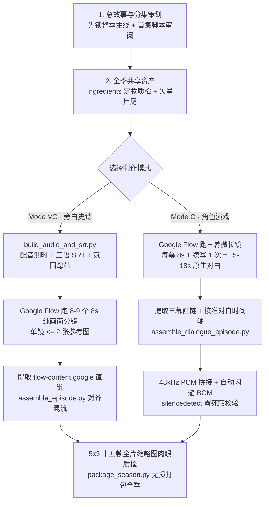

# Google Flow 连续故事视频全流程制作指南

本技能沉淀了一套经过多季实拍验证的工业化视频生产流水线，支持**电影旁白宣传片（Mode VO）**与**角色开口演戏连载动画（Mode C）**两种核心工艺，覆盖连续故事策划、定妆锁脸、Chrome 接管 Google Flow 生成、免弹窗签名 CDN 直链下载，以及 `ffmpeg` 无痕母带压制与全季无损打包。

- 配套自动化脚本：`./scripts/`（以本 `SKILL.md` 所在目录为基准，全局安装默认位于 `~/.agents/skills/google-flow-story-video/scripts/`）
- 数据结构与提示词公式：[manifest-schema-and-prompts.md](./references/manifest-schema-and-prompts.md)
- 最小可运行示例：[episodes.sample.json](./examples/episodes.sample.json)（Mode VO）、[dialogue-episode.sample.json](./examples/dialogue-episode.sample.json)（Mode C）、[mapping.sample.json](./examples/mapping.sample.json)、[sample-logo.svg](./examples/sample-logo.svg)

---

## 0. 整体架构与双模式选型（动工前必判）

开拍前先根据内容形态在以下两种成熟模式中二选一，**两者的音频与分镜先后顺序不同，严禁混串**：

| 维度 | Mode VO · 旁白史诗模式 | Mode C · 角色演戏动画模式 |
|---|---|---|
| **适用题材** | 世界观史诗宣传片、产品/游戏预告、起源传说 | 皮克斯 / 吉卜力式连载短剧、人物互怼/搞笑/催泪对手戏 |
| **声音来源** | **声音先行**：`build_audio_and_srt.py` 先生成统一神经旁白测定毫秒级时长，再反推镜头时长 | **演戏先行**：保留 Google Flow 原生角色口型对白与笑声/惊呼，后期叠加全程自动闪避 BGM（可选尾镜旁白点睛） |
| **分镜时序** | **8–9 个独立 8s 镜头**（单集总长 `60–75s`） | **三幕 × 15–18s 微长镜**（每幕在 SceneBuilder 最多续写 1 次，加片尾总长 **`48–55s`**） |
| **单集合成脚本** | `scripts/assemble_episode.py` | `scripts/assemble_dialogue_episode.py` |
| **全季打包脚本** | 共用 `scripts/package_season.py` | 共用 `scripts/package_season.py` |



---

## 1. 故事怎么讲（连续剧 × 单元爽片叙事法）

### 1.1 全季总纲先行与双层连续结构

- **先写整季总故事再拆单集**：无论是 10 集宣传片还是 30–100 集长连载，动工前必须先写出首尾呼应的整季总纲，再拆分单集，杜绝“脚踩西瓜皮”式的碎片感。
- **单集独立闭环 + 首尾咬合追更**：路人刷到中间任意一集也必须**零前置门槛看懂**，每集只打透一个核心冲突或反转；上一集最后 4 秒的悬念钩子（Cliffhanger），直接作为下一集前 3 秒的开屏引爆点。
- **审阅前置**：先输出整季分集大纲 + 第 1 集完整台词与分镜表供用户确认，获批后再批量跑片。

### 1.2 两种模式的黄金时序设计

#### A. Mode VO 单集四段式（60–75 秒 / 8–9 个 8s 镜头）

- **① 开屏即爽 Hook（`0–6s` / `s01`）**：第一句台词 + 第一帧画面直接抛出反常识冲突或奇观结果（例：*"She shattered into dust seven times—but refused to stay dead."*），可用第二人称 `"You"` 绑定观众视角。
- **② 规则具象化 & 危机（`6–28s` / `s02`–`s04`）**：用具象动作与短句交代本集危机，**禁止说明书式机制科普**。
- **③ 高潮兑现（`28–55s` / `s05`–`s07`）**：蜕变爆发、看穿杀招反制或绝地夺回。
- **④ 余韵 + 下集钩子（`55–68s` / `s08`–`s09`）**：末句点出 `Next: ...` 悬念，最后一镜短促切黑，接 `3.8–4.0s` 品牌片尾落版。
- **旁白语速与留白**：英文旁白控制在 **125–135 词/分钟**（单集 85–105 词），每镜配音前留 `0.30–0.45s` 呼吸，配音后留 `0.60–0.85s` 尾音。

#### B. Mode C 三幕微长镜时序（48–55 秒 / 三幕 × 15–18s）

为什么选 **15–18 秒/幕**？实测纯 8 秒独立分镜同场硬切跳跃感强；而同镜连续续写 2 次以上（达 `24–26s` 第 3 拍）画质会明显变软、角色动作僵化。**「每幕最多续写 1 次」是连贯度与画质锐度的最佳平衡点**：

| 幕次 | 拍数与时长结构 | 叙事功能与台词节奏 |
|---|---|---|
| **第一幕：入局抓人** | 首拍 `8s` + SceneBuilder 续写 1 次 `7–8s` = **`15–16s`** | 开场冲突立住人物关系；每拍英文台词 **≤ 10–12 词**（前 `4.5–5s` 说完，留 `2.5–3s` 表情动作反应，严防切词） |
| **第二幕：冲突升级** | 首拍 `8s` + SceneBuilder 续写 1 次 `7–8s` = **`15–16s`** | 切换到新机位/新空间推进交锋、搞笑互怼或危机爆发 |
| **第三幕：反转与钩子** | 首拍 `8s` + 续写 1 次 `7–8s`（长悬念可用 `+10s`）= **`15–18s`** | 反转高潮 + 结尾留 `2s` 戏剧静默悬念，切入 `3.8s` 品牌片尾落版 |

### 1.3 文案红线与多语外置字幕规范

1. **严守世界观边界**：正片对白/旁白与字幕中**不出现**「下载、充值、福利、代码、AI、区块链」等出戏词汇；品牌 Logo 与官网域名（**开拍前必须向用户核准精确域名**）只出现在片尾落版。
2. **干净无字母带 + 外置多语 `.srt`**：
   - 视频画面内**不烧录硬字幕、不贴 UI 框**；
   - 同步产出精确对轴的 `.en.srt`、`.ja.srt`、`.zh-Hans.srt`（支持扩展 `.zh-Hant.srt`、`.ko.srt`）；
   - **单屏字数上限**：英文单行 ≤ 32 字符、日文单行 ≤ 16 全角字符、中文单行 ≤ 14 字，每次最多 2 行；开拍前先锁死《多语专有名词与人名对照表》。

---

## 2. 视频怎么做（定妆锁脸 + 防黑边/防串色铁律 + 母带合成）

### 2.1 全季共享资产：Ingredients 定妆图与矢量片尾

1. **生成 6–8 张全季共享定妆图（Ingredients）**：
   - 覆盖核心角色（主角各阶段形态、关键对手/伙伴）、2–3 个常驻场景、1 个核心道具；
   - **严禁黑边后缀（关键铁律）**：图片与视频英文提示词中**切勿单独写 `dark calm lower third`**（实测 Flow 偶发在 `y ≈ 998` 处硬画整块纯黑底条破坏画幅）！所有定妆图与视频提示词末尾统一写死：
     ```text
     full-bleed 9:16 edge-to-edge, NO black bars, NO letterbox, NO borders, no text.
     ```
     画面底部的字幕暗部过渡统一交给后期 `ffmpeg geq` 无痕叠加。
   - **强制肉眼质检（`read_file` 逐张检视）**：
     - 非人类题材（灵体、水生生物、异兽、器灵）生图极易漂移出人类五官或美人鱼，一旦发现立即追加 `STRICTLY NO humans, NO human faces, NO humanoid torso, NO mermaids` 重抽；
     - 2D / 绘本 / 吉卜力或皮克斯特定画风项目，核查定妆图画风完全统一，杜绝混入写实摄影风资产。
2. **用本机无头 Chrome 渲染官方矢量片尾（禁止用 AI 画品牌 Logo）**：
   ```bash
   SKILL_DIR="${SKILL_DIR:-$HOME/.agents/skills/google-flow-story-video}"

   node "$SKILL_DIR/scripts/render_endslates.mjs" \
     --logo /path/to/official-logo.svg \
     --series "THE BOOK OF LIFE" \
     --volume "VOLUME I" \
     --domain "example.com" \
     --count 10 \
     --out-dir ./build/endslates
   ```

### 2.2 Mode VO 管线：配音先行与 `assemble_episode.py`

1. **先生成神经旁白、毫秒级 `timeline.json`、外置 `.srt` 与氛围音轨母带**：
   ```bash
   python3 "$SKILL_DIR/scripts/build_audio_and_srt.py" \
     --manifest episodes.json \
     --out-dir ./build/audio
   ```
2. **Flow 生成各镜画面并取回 `mapping.json` 后，合成单集母带**：
   ```bash
   python3 "$SKILL_DIR/scripts/assemble_episode.py" \
     --timeline ./build/audio/ep01/timeline.json \
     --audio ./build/audio/ep01/ep01-audio-master.wav \
     --endslate ./build/endslates/ep01-endslate.png \
     --mapping ./build/flow/ep01/mapping.json \
     --srt-dir ./build/audio/ep01 \
     --out-dir ./build/masters/ep01
   ```
   脚本自动完成：`geq` 幂函数无痕底部渐变、超 8s 台词 `setpts` 微幅平滑慢放对齐、音画时长误差 `< 0.35s` 校验，以及导出 **`qa-contact-5x3.png` 十五帧全片缩略图**。

### 2.3 Mode C 管线：原生演戏音频与 `assemble_dialogue_episode.py`

Mode C 直接保留 Google Flow 生成的角色口型对白音轨，严禁手写简陋拼接命令踩坑，直接运行专用合成脚本：

```bash
python3 "$SKILL_DIR/scripts/assemble_dialogue_episode.py" \
  --episode ./build/flow/ep01/dialogue-episode.json \
  --endslate ./build/endslates/ep01-endslate.png \
  --srt-dir ./build/subs/ep01 \
  --out-dir ./build/masters/ep01
```

**脚本内置的四大核心音频/视频工程护栏**：

1. **48kHz PCM 解码拼接（严禁多段 AAC `-f concat -c copy`）**：多段独立编码的 AAC 直接 `-c copy` 硬拼再送入滤镜，会因 AAC priming 时间戳错位导致音频提前十余秒截断。脚本统一走 `-filter_complex concat=n=N:v=1:a=1` 解码为 **48kHz 立体声 `pcm_s16le`** 后再混音。
2. **全程不断流 BGM + `sidechaincompress` 自动闪避**：Flow 原生音频在纯动作反应段常跌入 2–3 秒完全死寂。脚本自动铺设从 `0.0s` 贯穿至片尾结束的立体声氛围 BGM（支持内置 `tone` 合成或 `--bgm` 外部配乐），在角色开口时自动柔和压低 BGM、停顿时自然托起。
3. **`silencedetect` 零死寂与音画同步双断言**：成片压制后自动运行 `silencedetect=n=-45dB:d=1.0` 检测死寂区间，并硬校验 `abs(video_dur - audio_dur) < 0.35s`。
4. **15 帧 `5×3` 全片缩略图强制质检**：自动输出 `qa-contact-5x3.png`，交付前**必须用 `read_file` 打开肉眼核查**：零黑边、零角色串色、零写实/3D 风格漂移、零违和人形。

---

## 3. 怎么操作浏览器（连接 Chrome 与操控 Google Flow）

### 3.1 开启远程调试与处理 macOS `EPERM` 权限拦截

1. 请用户在已登录 Google 账号的 Chrome 中打开 **`chrome://inspect/#remote-debugging`**，勾选开启远程调试（确认显示 `Server running at: 127.0.0.1:9222`）。
2. **macOS `DevToolsActivePort` 权限报错处理**：
   - 若读取 `~/Library/Application Support/Google/Chrome/DevToolsActivePort` 报 `EPERM: operation not permitted`，**严禁尝试绕过系统权限**；
   - 直接提示用户在 macOS「**系统设置 → 隐私与安全性 → 完全磁盘访问权限（Full Disk Access）**」中勾选当前 Agent CLI 可执行文件（如 `/Users/<user>/.local/bin/agy`）与宿主终端应用（如 `Terminal.app`、`iTerm.app`、`Herdr.app`），授权后重连即可。

### 3.2 Google Flow 工作台标准参数（英 / 中 / 日三语对照）

连接 `https://flow.google.com/` 后，先核对参数再生成：

1. **检查积分与关闭可见水印**：右上角账户设置中确认积分充足，将 **Visible watermark / 可见水印 / 可視透かし** 设为 **OFF**。
2. **关闭底部对话 Agent 开关**：新建或进入项目后，**先关闭输入框内的 `Flow Agent` / `Flow 智能体` / `Flow エージェント` 开关**，露出完整参数栏。
3. **锁定生成参数**：

| 配置项 | 推荐值（英 / 中 / 日界面文案） | 说明 |
|---|---|---|
| 媒体类型 | `Video` / `视频` / `動画` | 切换为视频生成模式 |
| 生成模式 | `Ingredients` / `素材` | 挂载定妆图锁定角色与场景；首尾帧变形才切 `Frames` / `首尾帧` / `フレーム` |
| 模型选择 | **`Omni 1.2 Flash`** | 首选：一致性稳、原生口型自然、速度快；`720p + 9:16 + 8s + x1` 每镜 **24 积分**。仅当用户明确要求不计成本时才切 `Veo 3.1 - Quality` |
| 画幅与时长 | `9:16`（或 `16:9`）、`720p`、`8s` | 后期由脚本超采对齐至 `1080×1920` |
| 每次生成数 | **`x1`** | 省一半积分且速度快一倍；单拍不满意再单独重抽 |
| 微长镜续写 | `SceneBuilder` → `Extend` / `继续生成` / `続きを生成` | Mode C 专用：**每幕只续写 1 次**（选 `7s`/`8s`，尾钩可 `+10s`），严禁同幕续第 2 次 |

### 3.3 防串色、防沙盒报错与防风控三大操作纪律

1. **单镜最多挂 2 张参考图（防串色铁律）**：
   - 在 `Omni 1.2 Flash` 的 `Ingredients / 素材` 模式下，单镜同时挂载 **3 张及以上**参考图（如 `场景图 + 主角 + 配角`）极易触发**角色串色/串脸**（把配角配色染到主角身上）；
   - **标准挂法**：每镜严格控制在 **1–2 张参考图**——单人戏挂 `场景 + 角色A`；双人同框要么挂 `角色A + 角色B` 并用文字描述环境，要么先用 `场景 + 角色A` 生成首拍，再进 SceneBuilder 点 `Extend / 続きを生成` 引入 `角色B`。
2. **上传 Ingredients 的工作区中转与即时清理**：
   - `chrome_devtools` 的 `upload_file` 仅允许上传当前项目工作区根目录内的文件；
   - 先复制到 `<workspace>/.tmp-flow-ingredients/` 一次性上传至同一个 Flow 项目（全季各集共用同一项目永久复用），**上传完成后立即 `rm -rf <workspace>/.tmp-flow-ingredients/`**。
3. **8–12 秒自然提交间隔（防风控拦截）**：
   - 连续向 Flow 提交任务时，每次点击生成之间保持 **8–12 秒**自然间隔，并发排队不超过 2 条，避免高频连发触发异常活动拦截（`Unusual activity detected` / `检测到异常活动` / `通常とは異なるアクティビティが検出されました`）；
   - 一旦出现风控或验证弹窗，**立即停止自动化操作并通知用户在 Chrome 中手动刷新恢复**，严禁尝试任何绕过行为。
4. **双线并行量产**：第 $N$ 集全部镜头取回直链后，同一回合后台启动本地脚本压制第 $N$ 集，同时通过 `send_message` 复用同一个 `browser` 子代理开跑第 $N+1$ 集。

---

## 4. 怎么下载（提取签名 CDN 直链，绕开浏览器下载坑）

### 4.1 为什么不点网页「下载」按钮去 `~/Downloads` 找文件

在 DevTools 远程控制下点击下载菜单（`Original size (720p)` / `720p 元のサイズ`）会导致两个问题：

1. Chrome 常把文件存成无扩展名隐藏文件 `~/Downloads/.com.google.Chrome.XXXXXX`，常规搜索 `*.mp4` 找不到；
2. 自动化会话无法访问 `chrome://downloads/`，多镜连续下载极易发生镜号错乱。

### 4.2 标准方案：读取 `flow-content.google` 签名 CDN 直链 + `curl`

Google Flow 生成的每条 720p 视频（包括独立 8s 镜头与 SceneBuilder 合成后的 15s 微长镜导出流）底层均为有效期约 6 小时、**免 Cookie 可直接 HTTP 200 下载**的签名 CDN 地址：

```text
https://flow-content.google/video/<uuid>?Expires=...&KeyName=labs-flow-prod-cdn-key&Signature=...
```

1. 当集镜头生成完毕后，浏览器代理直接从 DevTools 网络日志（Network Log）或镜头预览页读取 `document.querySelector('video')?.currentSrc || document.querySelector('video')?.src`，核对镜号/幕号后返回 JSON。
2. 将直链写入 `mapping.json`（Mode VO）或 `dialogue-episode.json`（Mode C），由合成脚本自动 `curl -fsSL` 下载至 `<out-dir>/raw/` 并用 `ffprobe` 校验完整性。
3. 若超过 6 小时签名过期（HTTP 403），回 Flow 项目页刷新读取最新 `currentSrc` 即可，无需重跑消耗积分。
4. **应急兜底方案**：仅当页面改版无法读取 `<video>` URL 时，按严格镜号顺序间隔 3–5 秒点击下载，在终端用 `ls -tr ~/Downloads/.com.google.Chrome.*` 按时间排序并用 `ffprobe` 校验后重命名搬移。

---

## 5. 全季收官打包（分集交付包 + 无损全季合集）

Mode VO 与 Mode C 产出的单集母带文件名格式完全一致（`<slug>-flow-clean-master.mp4`），收官阶段统一运行 `package_season.py`：

```bash
python3 "$SKILL_DIR/scripts/package_season.py" \
  --manifest episodes.json \
  --masters-dir ./build/masters \
  --audio-dir ./build/audio \
  --series-slug my-story-s1 \
  --site-url https://example.com \
  --out-dir ./dist/my-story-s1
```

交付目录自动产出：

- `episodes/ep01..epXX/`：每集干净无字母带（`*-clean.mp4`）、内封多语软字幕审片版（`*-multilang.mp4`）及外挂 `.srt`；
- `full-movie/`：`ffmpeg -f concat -c copy` **零重编码无损拼接**的全季合集长片、自动累加精确时长偏移的全季多语 `.srt` 与软字幕合集版；
- `README.txt`：自动算好 `00:00 Episode 1...` 的 **YouTube Chapters 章节时间轴**与多语分集标题清单。
