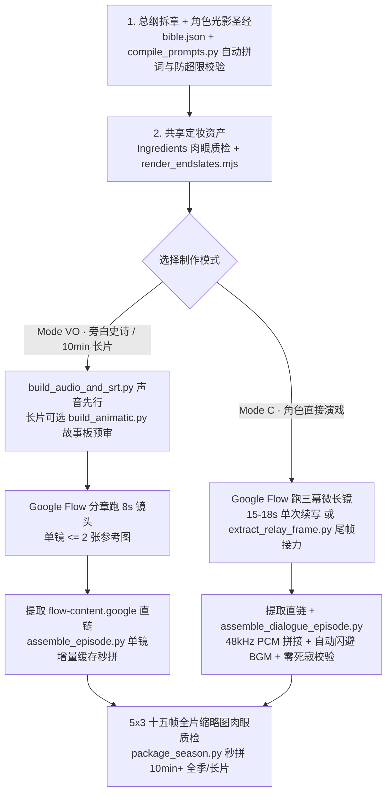

# Google Flow 连续故事与长片全流程制作指南

本技能提供一套模块化的工业级 AI 视频生产流水线，同时支持 **60s 竖屏连载短剧**与 **10 分钟级章节式长片**，覆盖**旁白史诗模式（Mode VO）**与**角色开口演戏模式（Mode C）**两种核心工艺：从「角色与光影圣经」自动拼词、零积分有声故事板预审、Chrome 接管 Google Flow 生成、真视频尾帧接力、签名 CDN 直链下载，到单镜级热替换缓存合成与全季无损打包。

- 配套自动化脚本：`./scripts/`（全局安装默认位于 `~/.agents/skills/google-flow-story-video/scripts/`）
- 数据结构与提示词公式：[manifest-schema-and-prompts.md](./references/manifest-schema-and-prompts.md)
- 最小可运行示例：[bible.sample.json](./examples/bible.sample.json)、[episodes.sample.json](./examples/episodes.sample.json)、[dialogue-episode.sample.json](./examples/dialogue-episode.sample.json)、[mapping.sample.json](./examples/mapping.sample.json)、[sample-logo.svg](./examples/sample-logo.svg)

---

## 0. 整体架构与双模式选型（动工前必判）

开拍前先根据题材选定模式，**两者的音频与分镜先后顺序不同，严禁混串**：

| 维度 | Mode VO · 旁白史诗模式 | Mode C · 角色演戏动画模式 |
|---|---|---|
| **适用题材** | 世界观史诗宣传片、10 分钟章节式纪录/传说长片、预告片 | 皮克斯 / 吉卜力式连载短剧、人物互怼/搞笑/催泪对手戏 |
| **声音来源** | **声音先行**：`build_audio_and_srt.py` 先生成统一神经旁白测定毫秒级时长，再反推镜头时长 | **演戏先行**：保留 Google Flow 原生角色口型对白与笑声/惊呼，后期叠加全程自动闪避 BGM |
| **分镜时序** | 每集/每章 **8–9 个独立 8s 镜头**（单章 `60–75s`；8–10 章即 10 分钟长片） | **三幕 × 15–18s 微长镜**（每幕续写 1 次，单集 **`48–55s`**；超长重头戏用**真视频尾帧接力法**续拍） |
| **前置预审** | 5–10 分钟长片先跑 `build_animatic.py` 出零积分**有声动态故事板**审节奏 | 先审整季总纲 + 第 1 集三幕台词表 |
| **单集合成** | `scripts/assemble_episode.py`（支持单镜增量热替换） | `scripts/assemble_dialogue_episode.py`（支持单幕增量热替换） |
| **全片/全季打包** | 共用 `scripts/package_season.py` 零重编码无损秒拼 | 共用 `scripts/package_season.py` 零重编码无损秒拼 |



---

## 1. 故事怎么讲（分章模块化 × 角色光影圣经）

### 1.1 总纲拆章与双层连续结构

- **先立总纲，再拆 60s 独立章节/分集**：无论是 10 集连载短剧还是 **10 分钟级 AI 长片**，切忌一次性生成一整坨长提示词。一律先把 10 分钟拆成 **8–10 个独立章节（每章 `50–75s`）**，每章只打透一个核心冲突或奇观；上一章末尾 4 秒悬念直接咬合下一章前 3 秒开屏钩子。
- **建立结构化「角色与光影圣经（`bible.json`）」**：
  - 长片或多集连载写到第 7、8 章时，手写 Prompt 极易发生画风词、色温词及 **Mode C 角色音色词（`voice_tag`）** 漂移；
  - 将全局 `style_anchor`、`lighting_anchor` 以及每个角色的 `visual_tag` + `voice_tag` + `ingredient` 存入 `bible.json`，运行 `compile_prompts.py` 自动注入所有分镜，并**在开拍前自动拦截「单镜超过 2 张参考图」与「单拍台词超过 12 词」两类致命错误**：
    ```bash
    SKILL_DIR="${SKILL_DIR:-$HOME/.agents/skills/google-flow-story-video}"

    python3 "$SKILL_DIR/scripts/compile_prompts.py" \
      --bible bible.json \
      --manifest episodes.raw.json \
      --out episodes.json \
      --sheet-out ./build/flow-shotlist.md \
      --strict
    ```

### 1.2 两种模式的黄金时序与「真视频尾帧接力法」

#### A. Mode VO 单章四段式（60–75 秒 / 8–9 个 8s 镜头）

- **① 开屏即爽 Hook（`0–6s` / `s01`）**：首句台词 + 首帧画面直接甩出反常识冲突或奇观结果；
- **② 规则具象化 & 危机（`6–28s` / `s02`–`s04`）**：具象动作交代危机，禁止说明书式科普；
- **③ 高潮兑现（`28–55s` / `s05`–`s07`）**：蜕变爆发、看穿杀招反制或绝地夺回；
- **④ 余韵 + 钩子（`55–68s` / `s08`–`s09`）**：末句点出下一章悬念，切入 `3.8s` 品牌落版（10 分钟长片的中间章节可将 `--endslate-seconds` 设为 `0` 或保留章节过渡卡）。
- **旁白语速**：英文 **125–135 词/分钟**，每镜前留 `0.30–0.45s` 呼吸，后留 `0.60–0.85s` 尾音。

#### B. Mode C 三幕微长镜（48–55 秒）与突破 15s 的「真视频尾帧接力法」

- **常规三幕（每幕 `15–18s`）**：每幕首拍 `8s` + SceneBuilder `Extend / 继续生成 / 続きを生成` **最多续写 1 次**（`+7~8s`，第三幕长悬念可 `+10s`）；每拍英文台词 **≤ 10–12 词**（前 `4.5s` 说完，留 `2.5–3s` 表情反应防切词）。**严禁在 SceneBuilder 内连续续写第 2 次（第 3 拍 `24–26s` 画质显著变糊）**。
- **突破 15s 画质衰减的王牌：真视频尾帧接力法（Last-Frame Relay）**：
  - **切勿全片每镜生硬绑定静态首尾帧**（跨构图强行 `Frames` 过渡极易在中途产生五官融化变形，也会丧失场间剪辑呼吸）；
  - 当某场重头戏确实需要 **24–32 秒同片场连续演下去**，或某段后半拍抽崩了只想局部重跑后 8 秒时，运行 `extract_relay_frame.py` 从前一段高清视频尾部自动挑出最锐利、未淡入黑场的清晰尾帧：
    ```bash
    python3 "$SKILL_DIR/scripts/extract_relay_frame.py" \
      --src "https://flow-content.google/video/<prev-clip-uuid>?..." \
      --out ./.tmp-flow-ingredients/relay-act1b.png
    ```
  - 将 `relay-act1b.png` 上传至 Flow 的 **`Frames / 首尾帧 / フレーム` 模式首帧槽位（仅锁首帧，不放尾帧！）** 生成新一段满血清晰度的 `8s` 片段——既重置了第 1 代锐度，又做到崩哪 8 秒只返工哪 8 秒。

### 1.3 文案红线与多语外置字幕规范

1. 正片对白/旁白与字幕中**不出现**「下载、充值、福利、代码、AI、区块链」等出戏词；品牌 Logo 与官网域名（**开拍前必须向用户核准精确域名**）只放在落版。
2. 母带画面**零硬字幕、零 UI 贴片**，同步生成 `.en.srt`（单行 ≤ 32 字符）、`.ja.srt`（≤ 16 字）、`.zh-Hans.srt`（≤ 14 字），每次最多 2 行。

---

## 2. 视频怎么做（故事板预审 + 防黑边/防串色 + 秒级热替换合成）

### 2.1 全季共享资产：Ingredients 定妆图与矢量片尾

1. **生成 6–8 张共享定妆图（Ingredients）并逐张 `read_file` 肉眼质检**：
   - **严禁黑边后缀**：图片与视频英文 Prompt 中**切勿单独写 `dark calm lower third`**（偶发触发 Flow 在 `y ≈ 998` 硬画黑底条），统一使用：
     ```text
     full-bleed 9:16 edge-to-edge, NO black bars, NO letterbox, NO borders, no text.
     ```
   - 非人类题材强制追加 `STRICTLY NO humans, NO human faces, NO humanoid torso, NO mermaids`；特定动画画风强制统一风格锚点，检出写实/人形漂移立即重抽。
2. **用无头 Chrome 渲染官方矢量片尾（禁止用 AI 画品牌 Logo）**：
   ```bash
   node "$SKILL_DIR/scripts/render_endslates.mjs" \
     --logo /path/to/official-logo.svg \
     --series "THE BOOK OF LIFE" \
     --volume "VOLUME I" \
     --domain "example.com" \
     --count 10 \
     --out-dir ./build/endslates
   ```

### 2.2 长片省积分利器：前置「有声动态故事板预审（Animatic Gate）」

制作 5–10 分钟长片（约 75–80 镜，直接跑视频需近 2000 积分）前，先在跑完 `build_audio_and_srt.py` 后一键生成零视频积分的**有声动态故事板 MP4**：

```bash
python3 "$SKILL_DIR/scripts/build_animatic.py" \
  --timeline ./build/audio/ep01/timeline.json \
  --audio ./build/audio/ep01/ep01-audio-master.wav \
  --ingredients-dir ./build/ingredients \
  --endslate ./build/endslates/ep01-endslate.png \
  --srt-dir ./build/audio/ep01 \
  --out ./build/animatics/ep01-animatic.mp4
```

先审视听节奏与分镜切换，改词或换图零积分损耗；确认无误后再进 Google Flow 批量跑动态镜头。

### 2.3 单集母带合成与「单镜级增量缓存秒级热替换」

两套合成脚本均内置 **URL 身份追踪（`raw/<id>.url`）+ SHA-256 分镜签名缓存（`*.sig`）**：当某一镜抽崩重跑、更新了 `mapping.json` / `dialogue-episode.json` 中的单条 URL 后直接重跑脚本，**脚本会自动只重拉并重编改动的那一镜，其余未改镜头 0 毫秒跳过并无损秒拼新母带**（如需强制全量重编可加 `--force`）。

- **Mode VO 合成**：
  ```bash
  python3 "$SKILL_DIR/scripts/assemble_episode.py" \
    --timeline ./build/audio/ep01/timeline.json \
    --audio ./build/audio/ep01/ep01-audio-master.wav \
    --endslate ./build/endslates/ep01-endslate.png \
    --mapping ./build/flow/ep01/mapping.json \
    --srt-dir ./build/audio/ep01 \
    --out-dir ./build/masters/ep01
  ```
- **Mode C 角色演戏合成**（内置 48kHz PCM 解码拼接防 AAC 截断、`sidechaincompress` 全程自动闪避 BGM、`silencedetect=n=-45dB:d=1.0` 零死寂校验与音画同步 `< 0.35s` 硬断言）：
  ```bash
  python3 "$SKILL_DIR/scripts/assemble_dialogue_episode.py" \
    --episode ./build/flow/ep01/dialogue-episode.json \
    --endslate ./build/endslates/ep01-endslate.png \
    --srt-dir ./build/subs/ep01 \
    --out-dir ./build/masters/ep01
  ```
- **交付前强制质检**：两套脚本均自动生成 `qa-contact-5x3.png`（全片 15 帧 `5×3` 缩略图矩阵），交付前必须用 `read_file` 打开肉眼核查：**零黑边、零串色、零风格漂移、零人形误画**。

---

## 3. 怎么操作浏览器（连接 Chrome 与操控 Google Flow）

### 3.1 开启远程调试与 macOS `EPERM` 权限授权

1. 请用户在已登录 Google 账号的 Chrome 打开 **`chrome://inspect/#remote-debugging`**，开启远程调试（`Server running at: 127.0.0.1:9222`）。
2. 若读取 `DevToolsActivePort` 报 `EPERM: operation not permitted`，**严禁尝试绕过权限**；直接提示用户在 macOS「**系统设置 → 隐私与安全性 → 完全磁盘访问权限**」中勾选当前 Agent CLI（如 `~/.local/bin/agy`）与终端应用（`Terminal.app` / `iTerm.app` / `Herdr.app`）。

### 3.2 Google Flow 标准参数（英 / 中 / 日三语对照）

1. 右上角账户设置确认积分充足，将 **Visible watermark / 可见水印 / 可視透かし** 设为 **OFF**。
2. 新建或进入项目后，**先关闭底部输入框内的 `Flow Agent` / `Flow 智能体` / `Flow エージェント` 开关**。
3. 锁定参数：

| 配置项 | 推荐值（英 / 中 / 日界面文案） | 用途与选型原则 |
|---|---|---|
| 媒体类型 | `Video` / `视频` / `動画` | 视频生成模式 |
| 生成模式 | `Ingredients` / `素材`（主力）<br>`Frames` / `首尾帧` / `フレーム`（接力/蜕变专用） | 常规演戏与叙事用 `Ingredients`；**24s+ 真视频尾帧接力（只挂首帧）**或**跨阶段形态蜕变（挂首尾两帧）**切 `Frames` |
| 模型选择 | **`Omni 1.2 Flash`** | `720p + 9:16 + 8s + x1` 每镜仅 **24 积分**，一致性与口型最佳 |
| 每次生成数 | **`x1`** | 省一半积分且速度快一倍；单镜崩了单独重抽后热替换即可 |
| 微长镜续写 | `SceneBuilder` → `Extend` / `继续生成` / `続きを生成` | 同幕最多续写 **1 次**；仍需继续同场演戏时改用 `extract_relay_frame.py` 尾帧接力 |

### 3.3 防串色、防沙盒拦截与防风控操作纪律

1. **单镜 ≤ 2 张参考图（防串色铁律）**：`Omni 1.2 Flash` 单镜挂 ≥ 3 张参考图极易发生角色配色互染。单人镜挂 `场景 + 角色A`；双人戏挂 `角色A + 角色B` 并文字写环境，或从首拍续写/尾帧接力引入第 2 角色。
2. **工作区临时目录上传与即时清理**：将定妆图或接力尾帧放入 `<workspace>/.tmp-flow-ingredients/` 完成 `upload_file` 上传后，**立即 `rm -rf <workspace>/.tmp-flow-ingredients/`**。
3. **8–12 秒自然提交间隔（防风控）**：每次提交保持 **8–12 秒**间隔、并发排队 ≤ 2 条；若遇 `Unusual activity detected / 检测到异常活动 / 通常とは異なるアクティビティが検出されました`，立即停止并请用户手动刷新，严禁绕过。
4. **双线并行**：复用同一 `browser` 子代理跑第 $N+1$ 章的同时，后台运行本地合成脚本压制第 $N$ 章。

---

## 4. 怎么下载（提取签名 CDN 直链，绕开浏览器下载坑）

不在 DevTools 下点网页下载按钮（避免落成 `~/Downloads/.com.google.Chrome.XXXXXX` 隐藏文件且无法访问 `chrome://downloads/` 导致串镜）。

1. 当章/当集镜头生成完成后，直接从 DevTools 网络日志或 `<video>.currentSrc` 提取有效期约 6 小时、免 Cookie 的签名 CDN 地址（`https://flow-content.google/video/<uuid>?Expires=...&KeyName=labs-flow-prod-cdn-key&Signature=...`），整理为 JSON 交给合成脚本自动 `curl -fsSL` 拉流并记录 URL 指纹。
2. 超过 6 小时签名过期（HTTP 403）时，回 Flow 项目页重新读取最新 `currentSrc` 即可（未改 UUID 的已下载原片不会重复拉取）。
3. 仅当页面改版无法读 `<video>` URL 时，才按严格镜号顺序间隔 3–5 秒点击下载，并用 `ls -tr ~/Downloads/.com.google.Chrome.*` + `ffprobe` 校验搬移。

---

## 5. 全季 / 10 分钟长片收官一键无损打包

8–10 个章节或全季各集全部质检通过后，运行 `package_season.py` 在数秒内完成零重编码无损拼接：

```bash
python3 "$SKILL_DIR/scripts/package_season.py" \
  --manifest episodes.json \
  --masters-dir ./build/masters \
  --audio-dir ./build/audio \
  --series-slug my-story-s1 \
  --site-url https://example.com \
  --out-dir ./dist/my-story-s1
```

自动输出各章/各集独立上传包（`episodes/`）、`ffmpeg -f concat -c copy` 秒级无损合集长片（`full-movie/`，自动累加每章精确时长顺延全片多语 `.srt`）以及带 **YouTube Chapters 章节时间轴**的 `README.txt`。
